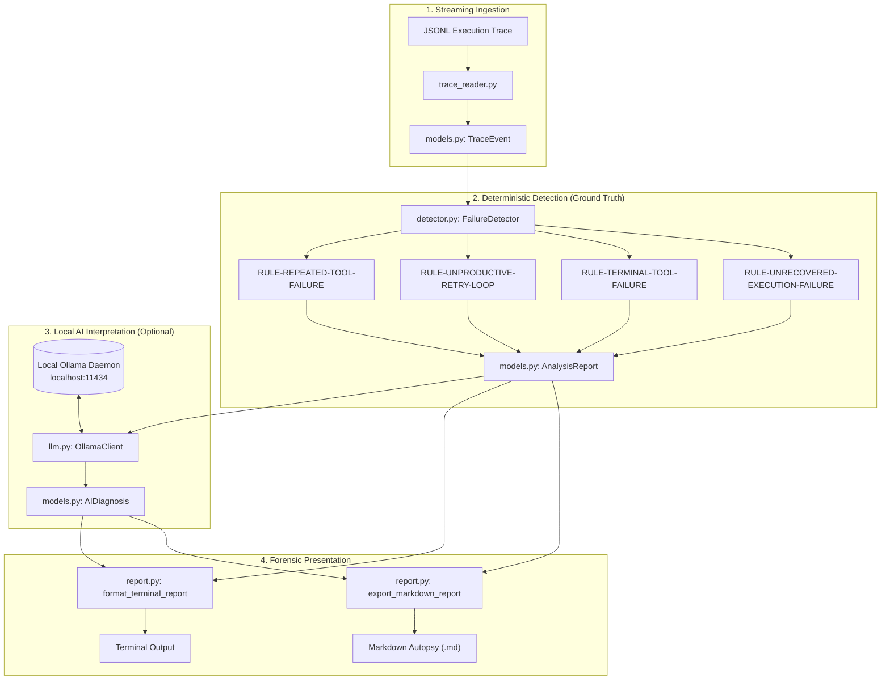

# Last Signal 📡👻

> **"Ghost in the Machine" — Offline-first digital autopsy CLI for investigating failed AI-agent executions.**

[](LICENSE)
[](pyproject.toml)
[]()
[]()

---

## 1. The Problem

Autonomous AI agents operate as dynamic loops: formulating plans, calling model APIs, invoking local or remote tools, and attempting retries upon failure.

When an agent fails, developers are typically left sifting through sprawling, noisy JSONL execution logs. Agents often fail in predictable yet subtle ways:
- **Looping on Broken Tools:** Invoking the same failing tool repeatedly without adapting parameters.
- **Unproductive Retry Cycles:** Exhausting token and retry budgets on non-transient infrastructure errors (e.g., connection refused, missing credentials).
- **Silent Terminal Crashes:** Encountering an unhandled tool exception immediately before dying without recording an explicit recovery path.

Traditional cloud observability platforms require sending sensitive internal trace logs to remote servers, violating privacy and local development workflows.

---

## 2. The Solution: Last Signal

**Last Signal** is an offline-first terminal CLI for investigating failed AI agents. Built around the theme **Ghost in the Machine**, it treats a failed agent session as a digital ghost, reconstructing its timeline and performing an evidence-grounded digital autopsy.

### Key Pillars:
1. **Deterministic Ground Truth First:** Rule-based detection algorithms identify repeated tool errors, broken retry loops, and terminal crashes using verifiable heuristics.
2. **Local AI Interpretation:** Connects strictly to a locally running Ollama instance (e.g. `llama3.2`) to synthesize natural-language hypotheses and debugging recommendations without sending any data off your machine.
3. **100% Offline Core & Fallback:** If Ollama is offline or `--no-ai` is passed, the core detector and report generator remain fully operational.
4. **Restrained Forensic Terminal UI & Markdown Autopsy:** Clean, accessible terminal timelines and structured GitHub-flavored Markdown report exports.

---

## 3. Architecture & Data Flow



---

## 4. Deterministic Failure Rules

Last Signal enforces four core forensic detection rules:

| Rule ID | Severity | Evidence Type | Detection Condition |
| :--- | :---: | :---: | :--- |
| **`RULE-REPEATED-TOOL-FAILURE`** | `CRITICAL` / `HIGH` | **Explicit** | A single tool records $\ge 2$ distinct failures during the execution. |
| **`RULE-UNPRODUCTIVE-RETRY-LOOP`** | `HIGH` | **Inferred** | An operation enters retries or repeated attempts without any subsequent recorded success. |
| **`RULE-TERMINAL-TOOL-FAILURE`** | `CRITICAL` | **Inferred** | A tool failure occurs immediately prior to session termination or unhandled abort. |
| **`RULE-UNRECOVERED-EXECUTION-FAILURE`** | `HIGH` | **Explicit** | The execution terminates with failure status without subsequent recovery operations. |

*Note on Evidence Basis:* Findings are explicitly labeled as **Explicit** (backed by logged error messages/statuses) or **Inferred** (derived from temporal sequence patterns).

---

## 5. Trace Event Schema

Last Signal accepts standard JSONL traces (one JSON object per line).

### Minimal Schema:
```json
{
  "timestamp": "2026-10-29T00:10:02Z",
  "trace_id": "tr-ghost-8812",
  "event_type": "tool_result",
  "operation": "run_migration",
  "attempt": 1,
  "status": "failed",
  "error_message": "OperationalError: connection to server at '127.0.0.1', port 5432 failed: Connection refused",
  "metadata": {"command": "alembic upgrade head"}
}
```

### Supported Fields:
- `event_type` *(Required)*: `agent_start`, `model_call`, `tool_call`, `tool_result`, `retry`, `agent_end` (accepts alias `event`).
- `operation`: Name of tool, model, or step executed (accepts aliases `tool`, `tool_name`, `action`).
- `status`: Outcome (`started`, `success`, `failed`, `error`, `pending`, `fatal`).
- `error_message`: Descriptive error text if an error occurred (accepts aliases `error`, `err`, `exception`).
- `attempt`: Sequence attempt number (integer).
- `timestamp`: ISO 8601 timestamp string.
- `trace_id`: Session correlation ID.
- `metadata`: Arbitrary key-value dictionary for parameters and context.

---

## 6. Installation

### Requirements
- Python 3.10 or higher
- Optional: [Ollama](https://ollama.com) (for local AI interpretation)

### Setup Virtual Environment
```bash
# 1. Clone repository
git clone https://github.com/sahilsaunke/last-signal.git
cd last-signal

# 2. Create and activate virtual environment
python3 -m venv venv
source venv/bin/activate

# 3. Install in editable mode
pip install -e .

# 4. (Optional) Install development & test dependencies
pip install pytest
```

---

## 7. Quickstart & CLI Commands

### A. View Available Commands (Help)
```bash
# Display command reference table
lastsignal help

# Detailed help for a specific command
lastsignal help analyze
```

### B. Run System Diagnostics
```bash
lastsignal doctor
```
Checks Python version, core parsing and detection engine, report file writing, and local Ollama connectivity.

### C. Analyze an Execution Trace
```bash
# Analyze using local AI (with automatic graceful fallback if Ollama is offline)
lastsignal analyze examples/repeated_tool_failure.jsonl

# Force deterministic-only mode (100% offline, zero network attempts)
lastsignal analyze examples/repeated_tool_failure.jsonl --no-ai

# Analyze and export a Markdown autopsy report
lastsignal analyze examples/repeated_tool_failure.jsonl --output reports/autopsy.md
```

### D. Direct Markdown Report Export
```bash
lastsignal report examples/repeated_tool_failure.jsonl --output reports/autopsy.md
```

### E. Direct Runner Script
You can also run Last Signal directly without installing the CLI binary:
```bash
python3 reader.py help
python3 reader.py examples/repeated_tool_failure.jsonl --output reports/autopsy.md
```

---

## 8. Local AI Configuration (Ollama)

To enable narrative AI-assisted explanations:

1. **Install Ollama** on your system:
   ```bash
   curl -fsSL https://ollama.com/install.sh | sh
   ```
2. **Pull a local model** (default: `llama3.2`):
   ```bash
   ollama pull llama3.2
   ```
3. **Run Last Signal:**
   ```bash
   lastsignal analyze examples/repeated_tool_failure.jsonl
   ```

To specify a different model or endpoint:
```bash
lastsignal analyze examples/repeated_tool_failure.jsonl --model qwen2.5:latest --ollama-url http://127.0.0.1:11434
```

---

## 9. Security, Privacy & Offline Integrity

- **Passive Ingestion Only:** Last Signal parses JSON logs passively. It **never executes shell commands, code, or scripts** found inside trace files or model responses.
- **Strictly Local Network Boundaries:** Ollama requests connect exclusively to `localhost` or the configured local URL. No cloud APIs (OpenAI, Anthropic, Google) are contacted.
- **Zero Telemetry:** No tracking, usage analytics, or remote update checks exist in the codebase.
- **Sanitized Reports:** Markdown and terminal outputs strip ANSI escape sequences, escape code fence breakouts, and neutralize HTML tags.

---

## 10. Automated Tests

Run the complete 42-test test suite:
```bash
pytest -v
```

Tests cover:
- Line-by-line JSONL streaming and malformed line reporting with exact line numbers
- Legacy field alias resolution (`tool`, `error`, `event`)
- Deterministic failure rules (repeated failures, retry loops, terminal aborts, recovery handling)
- Markdown report generation and nested directory creation
- Untrusted text sanitization and injection prevention
- Mocked Ollama HTTP client (success, timeouts, missing models, unavailable daemon, invalid responses)
- Doctor diagnostics command in offline and online modes

---

## 11. License

Last Signal is open-source software licensed under the [MIT License](LICENSE).
